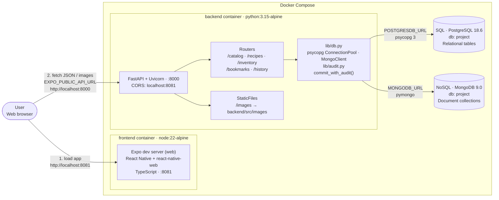
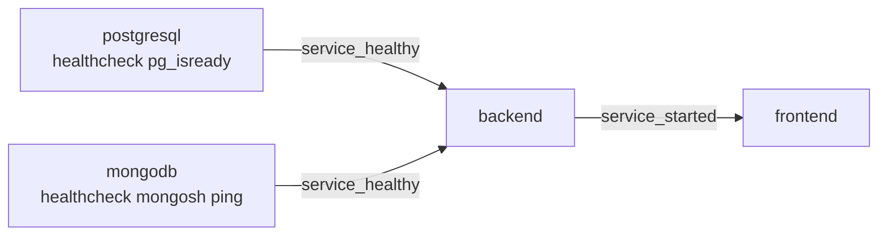
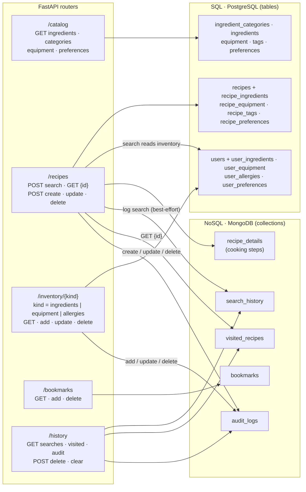
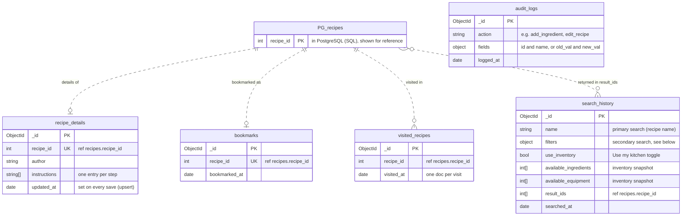
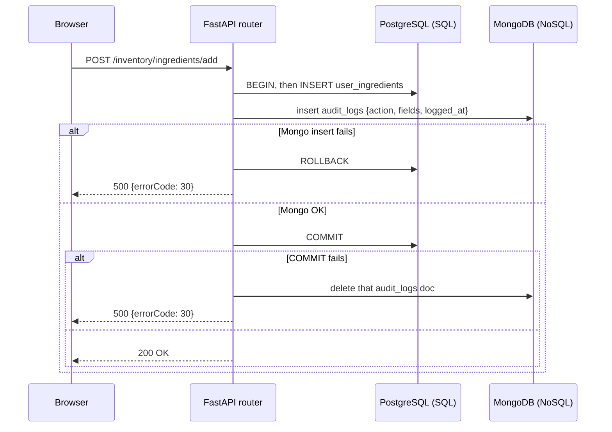
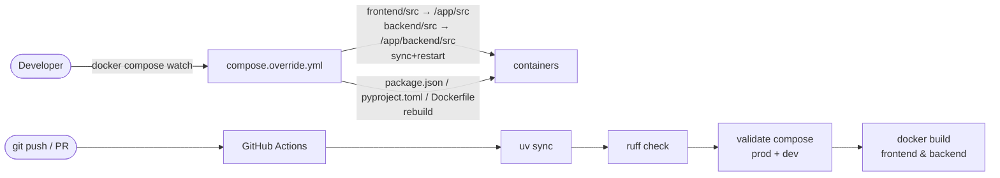

# System Architecture of "Order up!" RecipeFilterSystem

## 1. Overview

## 2. Containers (`compose.yml`)

| Service | Image / Build | Published port | Seed | Volume |
|---|---|---|---|---|
| frontend | `frontend/Dockerfile` (node 22, pnpm, `expo start --web`) | `${FRONTEND_PORT:-8081}:8081` | — | — |
| backend | `backend/Dockerfile` (Python 3.15, uv, FastAPI, Uvicorn) | `${BACKEND_PORT:-8000}:8000` | — | — |
| postgresql | `postgres:18.6-alpine` | internal 5432 | `01_schema.sql` ← `recipe_schema_ver_02.sql` `02_seed_user_demo.sql` `03_seed_recipes.sql` | `postgres_data` |
| mongodb | `mongo:9.0` | internal 27017 | `01_seed.js` ← `mongo_seed.js` | `mongo_data` |

The seed scripts in `/docker-entrypoint-initdb.d` run **only on an empty volume**.
To reseed, run `docker compose down -v`.

## 3. Backend API and data ownership

**Split of responsibilities**
- **SQL: PostgreSQL** holds structured, relational data: the catalog, recipes and their M:N relations, and the user's inventory, allergies and preferences.
  The search runs here: include/exclude filters and ranking by fewest missing ingredients, with staples counted as owned.
- **NoSQL: MongoDB** holds flexible documents and logs: cooking steps, bookmarks, search and visit history, and the audit trail.

## 4. Database diagrams

### 4.1 SQL: PostgreSQL ER diagram

### 4.2 NoSQL: MongoDB document schema

Database `project`, 5 collections. MongoDB has no foreign keys: `recipe_id` is a reference
the backend keeps in sync with `recipes.recipe_id` in PostgreSQL (dotted lines). Dates are
stored in UTC and returned as Thai time (UTC+7).

**Embedded objects**

| Collection.field | Shape |
|---|---|
| `search_history.filters` | `{include_ingredients, exclude_ingredients, include_categories, exclude_categories, include_preferences, exclude_preferences}`, each `int[]` |
| `audit_logs.fields` | add / delete: `{id, name}` · edit: `{old_val, new_val}` |

`audit_logs.action` is `add_`, `edit_` or `delete_` followed by `ingredient`, `equipment`, `allergy` or `recipe`.

**Indexes:** unique on `recipe_details.recipe_id` and `bookmarks.recipe_id`, created by `mongo_seed.js`.

**Who writes each collection**

| Collection | Written when | Read by |
|---|---|---|
| `recipe_details` | Recipe create / update (upsert) / delete, in the same transaction as PostgreSQL | `GET /recipes/{id}` |
| `bookmarks` | Heart button: `POST /bookmarks/add`, `/delete` | `GET /bookmarks` |
| `visited_recipes` | Automatically on `GET /recipes/{id}` | `GET /history/visited` |
| `search_history` | Submitted search: `POST /recipes/search` with `log: true` | `GET /history/searches` |
| `audit_logs` | Every inventory and recipe change, in the same transaction as PostgreSQL | `GET /history/audit` |

## 5. Cross-database consistency (write path)

## 6. Development and CI

## Tech stack summary

| Layer | Technology |
|---|---|
| Frontend | Expo 58, React 19.3, React Native 0.88 + react-native-web, TypeScript |
| Backend | Python 3.15, FastAPI, Uvicorn, psycopg 3 + psycopg-pool, pymongo |
| Databases | SQL: PostgreSQL 18.6 · NoSQL: MongoDB 9.0 |
| Tooling | Docker Compose (watch), uv workspace, pnpm, ruff, GitHub Actions |
